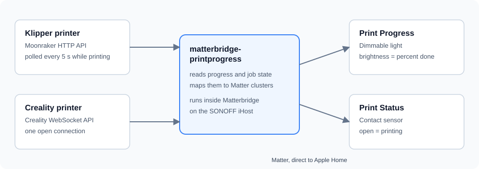
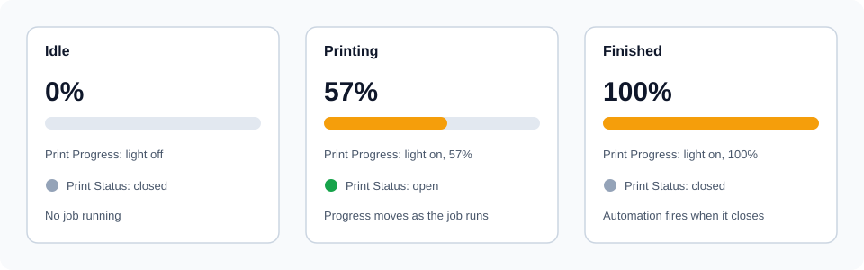
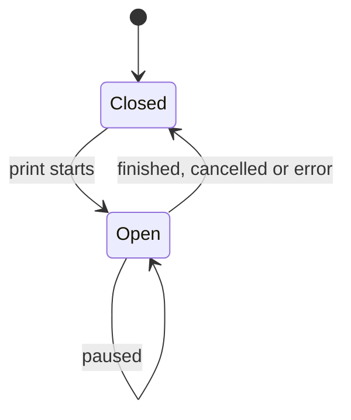

# matterbridge-printprogress

See your 3D printers' progress in Apple Home, live, as a normal Matter dimmable light. Works with Klipper (Moonraker) printers and Creality WebSocket printers, any number of them.



## Why this exists

The goal is simple: open the Home app and see how far a print is, and run an automation when a print ends.

Matter has no "print progress" device, so the plugin uses standard ones:

- a **dimmable light** whose brightness is the percentage done
- a **contact sensor** that tells you whether a print is running
- a second **contact sensor** that opens only when a print finishes successfully

This plugin grew out of [printpercent](https://github.com/MCKanpolat/printpercent), which published the same two accessories through the SONOFF iHost Matter Bridge. That bridge does not forward brightness changes from third-party devices, so Apple Home kept showing a stale value. Matterbridge talks Matter itself, and Apple Home updates live.

## What you get

For every printer you configure:

| Matter device      | Type           | Meaning                                                                                             |
| ------------------ | -------------- | --------------------------------------------------------------------------------------------------- |
| **Print Progress** | Dimmable light | Brightness equals percent complete. On while printing, off when idle.                               |
| **Print Status**   | Contact sensor | **Open** while a print is running or paused. **Closed** when idle, finished, cancelled or in error. |
| **Print Finished** | Contact sensor | **Opens** when a print completes successfully. **Closes** when the next print starts.               |



The light is read-only. If someone taps it in Apple Home, the plugin puts the real value back within a moment. Controls have no effect on the printer.

### Status sensor states



### Print finished automation

Build the automation in Apple Home with **A Sensor Detects Something**, then choose **Print Finished** and **Opens**. It fires only after a successful print. Cancelled prints and errors do not trigger it.

Print Finished opens only when the plugin sees a print go from running to completed. Restarting Matterbridge, or a printer that was already finished at startup, never fires it.

To react to any end of print, including cancelled ones, use **Print Status** and **Closes** instead.

## Supported printers

Support depends on the printer's API, not on the model. Any printer that speaks one of these works, and you can mix them.

| Printer API            | `type`      | `url` example            | Typical printers                                                           |
| ---------------------- | ----------- | ------------------------ | -------------------------------------------------------------------------- |
| Klipper with Moonraker | `moonraker` | `http://192.168.1.50`    | Snapmaker U1, Voron and other machines that run Klipper with Moonraker     |
| Creality WebSocket API | `creality`  | `ws://192.168.1.51:9999` | Creality printers on stock firmware that expose port 9999, such as the K1C |

The "typical printers" are examples of firmware families. Tested so far on a **Snapmaker U1** (Moonraker) and a **Creality K1C** (WebSocket). If your printer works or does not, an issue report helps.

Moonraker progress follows the position in the G-code file, so it matches what the printer shows.

## Requirements

- Matterbridge 3.10 or newer, running on Node 22 or newer
- Printers reachable on your network from the Matterbridge host

## Install

In the Matterbridge web UI, type `matterbridge-printprogress` in the plugin field, press **Install**, then restart Matterbridge.

From a terminal on the Matterbridge host:

```bash
matterbridge -add matterbridge-printprogress
```

To install a build from source instead, run `npm install`, `npm run build` and `npm pack`, then press **Upload** in Matterbridge and choose the tarball.

## Configure

Open the plugin's settings in Matterbridge, or edit `matterbridge-printprogress.config.json`.

```json
{
  "name": "matterbridge-printprogress",
  "type": "DynamicPlatform",
  "printers": [
    {
      "id": "u1",
      "name": "Snapmaker U1",
      "type": "moonraker",
      "url": "http://192.168.1.112",
      "manufacturer": "Snapmaker",
      "model": "U1"
    },
    {
      "id": "k1c",
      "name": "Creality K1C",
      "type": "creality",
      "url": "ws://192.168.1.78:9999"
    }
  ],
  "pollingInterval": 5,
  "idlePollingInterval": 15
}
```

| Setting               | Default     | Meaning                                                                                                    |
| --------------------- | ----------- | ---------------------------------------------------------------------------------------------------------- |
| `printers[].id`       | required    | Unique id, letters, numbers and hyphens. It becomes the device serial, so changing it creates new devices. |
| `printers[].name`     | required    | Base name. Devices are called `<name> Print Progress`, `<name> Print Status` and `<name> Print Finished`.  |
| `printers[].type`     | `moonraker` | `moonraker` or `creality`.                                                                                 |
| `printers[].url`      | required    | `http(s)` for Moonraker, `ws(s)` for Creality.                                                             |
| `printers[].apiKey`   | none        | Moonraker API key, only if your instance needs one.                                                        |
| `pollingInterval`     | `5`         | Seconds between reads while a printer is printing.                                                         |
| `idlePollingInterval` | `15`        | Seconds between reads while idle or offline.                                                               |

## Light on the CPU

Built to run on a small gateway such as the SONOFF iHost.

- The Creality printer keeps **one WebSocket open**. A read costs no network round trip, and the plugin reconnects with backoff if it drops.
- Reads slow down to every 15 seconds when nothing is printing.
- Moonraker file metadata is fetched once per file, not on every read.
- Matter attributes are written only when a value actually changes.

## Troubleshooting

| Symptom                                 | What to check                                                                                                                                  |
| --------------------------------------- | ---------------------------------------------------------------------------------------------------------------------------------------------- |
| Devices show as not responding          | The plugin cannot reach the printer. Check the `url` and that the printer is on. The plugin logs one warning when it loses a printer.          |
| New devices do not appear in Apple Home | Restart Matterbridge, then check that the plugin is enabled and its status is Running.                                                         |
| Progress looks stale                    | Confirm the plugin version is current and that Matterbridge is paired with Apple Home.                                                         |
| A Creality printer always reads 0%      | The printer must expose its WebSocket API, usually on port 9999. Some firmware does not.                                                       |
| A Klipper printer fails to read         | Open `http://<printer>/printer/objects/query?print_stats=state` in a browser. If it does not answer, Moonraker is not reachable at that `url`. |

## Development

```bash
npm install
npm install --no-save --no-package-lock matterbridge@^3.10.0
npm run verify
```

`verify` runs the type check, build, lint, format check and tests.

## Related

- [printpercent](https://github.com/MCKanpolat/printpercent): the original iHost bridge this plugin replaces
- [Matterbridge](https://github.com/Luligu/matterbridge)

## License

Apache-2.0
